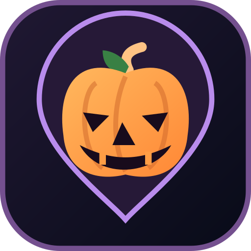

# Halloween Map

**Une carte, des maisons accueillantes et une nuit pleine de surprises.**

L'application qui relie les familles, les habitants et les organisateurs pour vivre Halloween autrement.

**🎃 Application web installable · 🗺️ Balades et collecte de bonbons · ✨ Une création DomotiK Studio**

---

## Et si tout Halloween tenait sur une carte ?

Chaque année, des maisons se décorent, des habitants préparent des surprises et des familles partent à la recherche de bonbons. Mais où aller ? Quelles maisons participent ? À quelle heure les portes s'ouvrent-elles ? Et quelle ambiance attendre ?

**Halloween Map** rassemble tout au même endroit : une carte interactive des maisons participantes, des informations utiles pour préparer sa soirée et une véritable expérience de collecte à vivre à son rythme.

L'idée est simple : **faire de la traditionnelle chasse aux bonbons une balade conviviale, organisée et pleine de découvertes**, sans enlever ce qui fait le charme d'Halloween : la surprise.

## Une expérience pour tout le monde

### 👻 Pour les visiteurs et les familles

Explorez les maisons participantes sur la carte, découvrez leurs activités et préparez une sortie adaptée à vos envies.

- **Des maisons à découvrir** : leurs horaires, les activités proposées et les informations utiles pour la visite.
- **Une ambiance à votre mesure** : niveaux de frayeur et possibilité, pour certaines maisons, d'adapter les frissons à leurs visiteurs.
- **Un parcours à préparer** : sélectionnez les étapes qui vous intéressent et obtenez une proposition de trajet à pied.
- **Une collecte libre** : une fois partis, visitez les maisons dans l'ordre que vous préférez et suivez celles déjà parcourues.
- **Votre progression** : retrouvez vos visites, votre avancée et le bilan de votre balade.

Halloween Map accompagne la soirée, mais **vous gardez le contrôle de votre parcours**. Ce n'est pas une navigation vocale, et rien ne vous oblige à suivre les étapes dans un ordre imposé.

### 🏠 Pour les habitants qui ouvrent leur porte

Parce que Halloween ne serait rien sans les maisons qui jouent le jeu !

Créez votre compte, proposez votre maison à l'événement et indiquez ce que les visiteurs peuvent y trouver : **bonbons, animations, accueil, horaires, ambiance et informations pratiques**.

Vous gardez la main sur votre participation : vous pouvez mettre à jour votre présentation, signaler une indisponibilité ou une rupture de bonbons et adapter l'accueil à la réalité de la soirée. Les propositions de maisons passent par une validation de l'organisation avant leur apparition sur la carte publique.

### 🎃 Pour les communes, associations et organisateurs

Halloween Map est aussi un outil pour donner vie à un événement local.

Depuis un espace d'administration dédié, les organisateurs peuvent préparer leur saison, examiner les inscriptions, gérer les maisons participantes, informer les utilisateurs et consulter les statistiques de l'événement.

La gestion complète se fait sur ordinateur ; sur mobile, l'administration propose **une consultation simplifiée des statistiques**. Des modèles d'emails personnalisables et des campagnes permettent également de communiquer avec les participants.

## Une soirée qui prend vie au bon moment

<strong>Avant Halloween — la préparation</strong>

Les maisons s'inscrivent, les organisateurs préparent l'événement et un compte à rebours annonce l'ouverture. Les visiteurs peuvent découvrir l'événement sans que les adresses des maisons soient affichées trop tôt.

<strong>Le soir venu — place à la carte !</strong>

À l'ouverture officielle, les visiteurs connectés retrouvent les maisons disponibles, choisissent leurs visites et peuvent lancer leur collecte. Les horaires et les disponibilités des maisons sont pris en compte.

<strong>Après la fête — les souvenirs restent, pas les adresses</strong>

La carte de la saison se referme. Les organisateurs peuvent retrouver des résultats agrégés de l'événement ; les données personnelles des participations saisonnières sont supprimées selon le calendrier prévu. Les comptes peuvent être réutilisés pour les saisons suivantes.

## Une application à emporter dans sa poche

Halloween Map est une **application web installable (PWA)**. Elle fonctionne depuis un navigateur, sur téléphone comme sur ordinateur, et peut être ajoutée à l'écran d'accueil d'un smartphone pour retrouver une expérience proche de celle d'une application classique.

Son univers visuel mêle **nuit, citrouilles, teintes orangées et violettes** : une atmosphère Halloween assumée, mais une navigation conçue pour rester claire et pratique.

La carte et le suivi d'une collecte nécessitent une connexion Internet. L'application ne promet pas de guidage vocal ou de navigation complète hors ligne.

## Pensée pour un événement responsable

Derrière la magie de la soirée, quelques principes comptent :

- **Des maisons volontaires et validées** avant leur présence sur la carte.
- **Une carte saisonnière**, qui ne dévoile pas les participations avant l'ouverture prévue.
- **Des comptes réutilisables**, sans conserver indéfiniment les adresses et les détails de participation d'une ancienne saison.
- **Une progression personnelle**, sans stockage serveur d'un trajet GPS complet de chaque visiteur.

Les modalités précises de confidentialité et les règles de participation sont définies dans les documents de l'événement par son organisateur.

## Un projet qui grandit

Halloween Map est un projet indépendant imaginé par **DomotiK Studio**, avec une idée toute simple : mettre la technologie au service d'un moment convivial entre voisins, sans lui faire voler la vedette.

L'application évolue encore en **version bêta**. Les retours d'expérience et les idées de la communauté contribuent à la faire progresser, saison après saison.

**[Découvrir les versions et nouveautés](https://github.com/Mick7784/halloween-map/releases)**

---

Pour les personnes qui déploient ou contribuent au projet, l'ancienne documentation technique est conservée dans les [archives techniques](docs/README-technique-historique.md). Ce README présente volontairement l'application plutôt que son installation.
