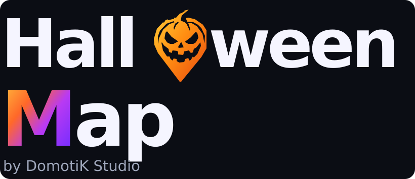
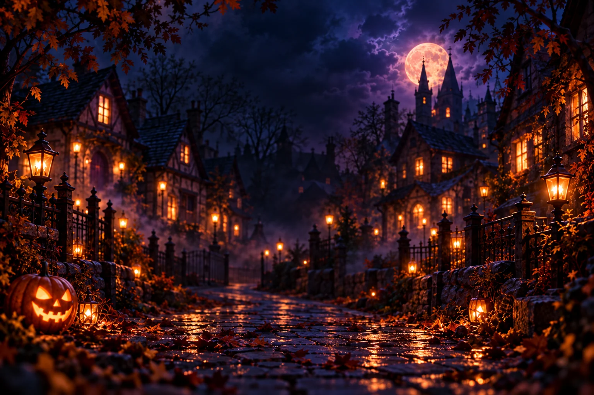

 

### Une carte. Des maisons. Une nuit d'Halloween à partager. 🎃

**Halloween Map** permet aux habitants de signaler leur maison et aux familles de découvrir les participations autour d'elles, pour une balade et une collecte de bonbons à leur rythme.

**Une application de [DomotiK Studio](https://domotik-studio.fr/)**, dans le même écosystème que **LinKs**, avec sa propre identité orange, violet et nuit d'Halloween.

[Découvrir l'application](https://halloween-map.domotik-studio.fr/) · [Comment ça marche](#comment-ça-marche) · [Fonctionnalités](#les-fonctionnalités) · [Vie privée](#respect-de-la-vie-privée)

---

## Halloween, maison après maison

Halloween Map est une **carte participative et une application web installable (PWA)**. Les habitants peuvent proposer leur maison, indiquer leurs horaires et leurs activités, puis signaler une pause, une fermeture ou une rupture de bonbons.

Les visiteurs connectés découvrent les maisons disponibles pendant la période d'ouverture de la carte et préparent librement leur balade. **Il n'y a pas d'itinéraire imposé, de guidage vocal ni de rassemblement organisé par l'application.**

## Comment ça marche

**🏠 Pour les habitants** — Créer un compte, inscrire sa maison, préciser les horaires, les animations éventuelles et les indications pratiques. La maison est soumise à validation. Son propriétaire peut ensuite mettre à jour sa disponibilité, y compris lorsque les bonbons sont épuisés.

**🍬 Pour les visiteurs** — Se connecter lorsque la carte est accessible, consulter les maisons participantes et préparer une sélection. Pendant la collecte, chacun décide de son chemin, peut utiliser sa position GPS et marquer les visites effectuées. Le récapitulatif rassemble la progression et les informations de la collecte.

**🛠️ Pour l'administration** — Valider les maisons, gérer les comptes et les autorisations, paramétrer les saisons et leurs dates, administrer les communications et consulter des statistiques agrégées. Le back-office complet s'utilise sur ordinateur ; sur mobile, l'administration propose uniquement des statistiques en lecture seule.

## Les fonctionnalités

| | Fonctionnalité | Ce qu'elle apporte |
|:--:|---|---|
| 🗺️ | **Carte participative** | Maisons validées, horaires, activités et disponibilité |
| 🎭 | **Frissons adaptés** | Identification des maisons pouvant adapter leur mise en scène à l'âge ou à la sensibilité des visiteurs |
| 🍬 | **Collecte libre** | Sélection personnelle de maisons, visites déclarées et suivi de progression |
| 📍 | **Géolocalisation facultative** | Position sur la carte, proximité des maisons et orientation sur certains appareils compatibles |
| 📆 | **Saisons** | Préparation, activation et ouverture de la carte selon un calendrier défini |
| 🏠 | **Gestion des maisons** | Inscription, modération, pause, fermeture et état des bonbons |
| ✉️ | **Communications** | Emails de compte, notifications, campagnes et éditeur HTML sécurisé |
| 📊 | **Statistiques** | Indicateurs et données agrégées destinés à l'administration |
| 📱 | **Application installable** | PWA sur Android, iPhone et ordinateur, sans passage obligé par une boutique d'applications |

## Une identité dans l'écosystème DomotiK Studio

Le logo **Halloween Map** reprend la signature des applications **DomotiK Studio** : typographie forte, une lettre-symbole immédiatement reconnaissable et un dégradé de couleur propre à chaque univers.

Ici, le **O de Halloween** reprend la **citrouille en forme de repère GPS** de l'icône officielle. Le mot **Map** adopte un dégradé orange-violet, tandis que l'icône conserve son village nocturne, sa lune et sa carte.

Le logo de présentation et l'icône d'application ont des rôles distincts : l'un signe le projet et ses supports ; l'autre identifie l'application sur l'écran d'accueil et dans le navigateur.

## Respect de la vie privée

La carte et les fonctionnalités de collecte sont réservées aux utilisateurs connectés pendant les périodes autorisées. La géolocalisation est facultative ; Halloween Map n'est **pas** un service de suivi en direct des déplacements des visiteurs.

Les données des participations sont liées aux saisons et soumises à des règles de conservation et de purge. La reprise d'une collecte peut s'appuyer sur un stockage temporaire de l'appareil. Les informations détaillées figurent dans la [politique de confidentialité](https://halloween-map.domotik-studio.fr/privacy).

**Avant l'ouverture publique**, l'exploitant doit compléter et publier les coordonnées, mentions légales et durées de conservation correspondant à son instance.

## État du projet

Halloween Map est actuellement proposé en **Beta**. La version du code figure dans [VERSION](VERSION) et ses évolutions dans le [CHANGELOG](CHANGELOG.md).

Le fonctionnement réel des emails, de la géolocalisation, des smartphones et de la sauvegarde doit être vérifié sur l'instance hébergée avant une ouverture au public.

## Documentation et contribution

Pour les personnes souhaitant installer ou maintenir Halloween Map :

- [Installation, déploiement et exploitation](docs/OPERATIONS.md)
- [Saisons et règles de fonctionnement](docs/seasons.md)
- [Checklist avant l'ouverture publique](docs/GO-LIVE.md)
- [Historique des versions](CHANGELOG.md)
- [Signaler un problème ou proposer une amélioration](https://github.com/Mick7784/halloween-map/issues)

---

**Halloween Map — Une nuit à partager.**

*Une création DomotiK Studio.*

